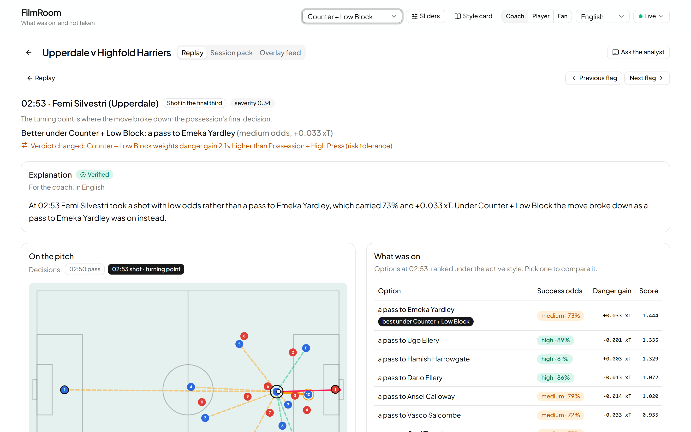
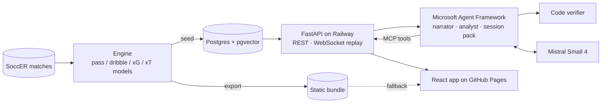

# FilmRoom

**An AI film-room analyst that finds the moments where a clearly better option was on, judges them against the coach's own tactical style, and explains them to coaches, players and fans, with every number checked.**

**Live app:** https://vlyot.github.io/filmroom/ · **Demo video:** _link added at submission_

Built for the Microsoft × Premier League "Inside the Game" hackathon, on synthetic match data.

## The problem

After a match, an analyst spends hours cutting video to find the few possessions worth showing the squad. The moments that matter aren't always the goals and the chances. They are the ones where the move broke down while a better pass was on. What counts as "better" depends on the coach: a possession side and a counter-attacking side would judge the same moment differently. And whatever an AI says about it has to be right, because a coach who catches one invented number stops trusting the rest.

## What it does

- **Flags moments live.** Replay a match on its clock (1× to 10×). Each possession is analysed as it ends, and the ones where a clearly better option was available are flagged at once.
- **Shows what was on.** For each flagged moment: a pitch replay with the option lanes, the danger curve, and every alternative with its success band and threat, ranked under the coach's style.
- **Changes with the coach's style, and says why.** Six presets (Possession, Direct or Counter with the ball; High Press, Mid-Block or Low Block without it) or four custom sliders. When the verdict changes, the app names the principle and the factor that flipped it.
- **Explains it for coach, player or fan, in English or Spanish.** Short narratives from Mistral, where code fills every number and name and a verifier rejects anything the model wrote that the engine didn't.
- **Builds the session.** A session pack ranks the team's moments for half-time or full-time, groups them into themes and counts how other styles would judge them.
- **Answers questions.** Ask the analyst, e.g. "Show me possessions we lost in midfield after a switch of play". It calls the engine through MCP and cites the possessions it means.
- **Feeds broadcast.** An overlay JSON feed gives one event per flagged moment with captions in every language.
- **Stays up.** If the API stops answering, the app switches to a static bundle, keeps replaying and judging in the browser, says so in the header, and switches back when the API returns.

## How it works

- **Engine:** deterministic Python. It splits each match into possessions as events arrive and values every alternative at each decision. Each match is analysed with models fitted on the other matches.
- **Tactical lens:** a style is four sliders, factor weights are a linear function of them, and each factor is moved by at most one slider. So every verdict change traces to one factor and the slider behind it.
- **Agents:** Microsoft Agent Framework over six read-only engine tools served by MCP.
  - The narrator writes around `{slot}` placeholders.
  - The analyst writes no numbers.
  - The session pack is a five-step workflow.
- **Delivery:** GitHub Actions tests every push and deploys the API to Railway, then GitHub Pages serves the app. Postgres holds the engine output, the narrative cache and the token ledger, and pgvector finds similar situations.

More in [architecture](docs/architecture.md).

## Results

Measured at the frozen commit `bfa7a57`; method and limits in [evaluation](docs/evaluation.md).

| Check | Result |
| --- | --- |
| Pass model calibration, out of fold | 5,446 real passes: ECE 0.021, Brier 0.154 (0.175 for the base rate) |
| What was on instead: labelled better player in the engine's top 3 | 12 of 22 (55%, 95% CI 35–73%); random 30% |
| Verifier | 2,268 of 2,268 injected errors caught, English and Spanish |
| Style lens | 2,585 of 2,585 verdict flips traced to one named factor; 0 slider-direction violations |
| Live latency | Template at the moment the possession ends; verified narrative in about 2 s |
| Reliability | API stopped in a drill: the site kept working from the bundle and returned to live afterwards |

The pass model is checked against thousands of real outcomes. The "what was on instead" labels are 22 AI-drafted, human-reviewed possessions written by the same author as the engine, so that score is agreement with our own reference set, not independent accuracy.

## Judging criteria

| Criterion | Where to look |
| --- | --- |
| Technological implementation | Synthetic data pipeline over SoccER ([data](docs/data.md)); calibrated models; leave-one-match-out evaluation; no-lookahead, contract and browser-parity tests in CI |
| Agentic design and innovation | Agent Framework narrator, analyst and session-pack workflow; engine tools over MCP; a code verifier that keeps every number honest |
| Real-world impact | The film-session workflow: flag, explain, rank, share. Deployed with a static fallback, monitoring, a token budget and template fallbacks |
| User experience and presentation | Live replay, the style switch that names its reason, coach / player / fan views in two languages, the demo video |
| Hackathon category | Synthetic football events turned into explainable match intelligence, live and in several languages |

## Built with

- **Microsoft Agent Framework:** narrator, analyst and the session-pack workflow
- **Model Context Protocol:** the engine's tools at `/mcp`, open to any MCP client
- **GitHub Actions:** tests, evaluation checks, image build and deploy on every push
- **GitHub Pages:** the app
- Also: Railway (API, Postgres with pgvector), Mistral Small 4, FastAPI, React with shadcn/ui

## Data

FilmRoom runs on SoccER (L. Morra et al., ICIAR 2020), synthetic matches from the open-source Gameplay Football engine. Every player and team name is replaced with a fictional one, and no game footage is used. The dataset isn't in this repository. See [data](docs/data.md) for the citation and what is published.

## Docs

- [Architecture](docs/architecture.md)
- [Evaluation](docs/evaluation.md)
- [Data](docs/data.md)
- [Decisions](docs/decisions.md)
- [Development](docs/development.md): setup, commands, deploy

Code under the [MIT licence](LICENSE); the SoccER data is not covered.
