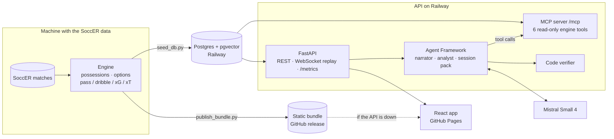

# Architecture

FilmRoom has four parts: a deterministic **engine** that analyses possessions, a **tactical lens** that judges options under a coach's style, an **agent layer** that explains the verdicts and answers questions, and a **web app** that replays a match live. One rule runs through all of them: the engine computes, the LLM explains.

## Engine (`src/filmroom/engine`)

- **Possessions** are split incrementally as events arrive. Each is analysed only on data up to the frame it closed, so a live replay can flag it the moment it ends.
- **Decisions** are every pass, shot and the final carry when a player loses the ball without releasing it. At each, the engine lists the alternatives (every teammate as a pass target, a carry, a shot) and values each with a pass model, a dribble model, an xG model and Karun Singh's xT grid.
- **Factors.** Each option also gets the factors the lens weighs: success probability, danger gained, progression, switch of play, counter-press cover and rest defence.
- **Turning point and flags.** The turning point is the possession's final decision. A possession is flagged when the best alternative beats the choice by more than a threshold fitted over all matches (no labels).
- **Leave one match out.** Every match is analysed with models fitted on the others.

## Tactical lens (`src/filmroom/style.py`, `styles.json`)

- **Scoring.** A style is four sliders (risk tolerance, verticality, press trigger, defensive line height). Factor weights are a linear function of them, and an option's score is the weighted sum of its factors.
- **Flip reasons.** Each factor is moved by at most one slider. When two styles pick different options, the factor that contributes most to the change names the principle, and the slider, behind it. That reason is shown in the app.
- **Presets.** Six presets pair a with-the-ball rule set (Possession, Direct, Counter) with a without-the-ball one (High Press, Mid-Block, Low Block).

## Agent layer (`src/filmroom/agents`)

- **MCP server** (`/mcp`, streamable HTTP). Six read-only tools over the store:
  - `list_flagged_moments`
  - `get_possession`
  - `find_turning_point`
  - `evaluate_options`
  - `compare_styles`
  - `search_similar_situations`

  `search_similar_situations` is a pgvector cosine search over one 25-number vector per moment and style. Any MCP client can call the tools.
- **Narrator.** One Microsoft Agent Framework call per flagged moment, audience (coach, player, fan), language (English, Spanish) and style.
  - The model writes text with `{slot}` placeholders and claims; code fills the slots from the engine's facts, with locale formatting.
  - The template is shown at once, and the verified narrative replaces it, usually within about 2 seconds.
- **Verifier.** Plain code. It rejects digits, spelled-out numbers, names outside slots, unknown slots, and claims that contradict the verdict under the active style. A rejected draft is retried once, then the template stays.
- **Analyst** (`POST /analyst`). A tool-calling Agent Framework agent over the MCP tools. It writes no numbers: it cites the possessions it talks about, and the app shows their numbers from the engine.
- **Session pack.** An Agent Framework workflow:
  1. `SelectMoments` ranks the team's flagged moments.
  2. `CompareStyles` counts how the other presets judge each one.
  3. `GroupThemes` groups them into themes.
  4. `Narrate` explains each moment.
  5. `Assemble` builds the pack for half-time or full-time.
- **Budget and cache.**
  - Every model call goes through a daily token cap and is recorded in a Postgres ledger, so the cap holds across restarts.
  - Results are cached by a hash of everything that went into them (facts, verdict, prompt version, model), so nothing stale is served.
  - Without a key, or past the cap, everything still works on templates.

## API (`src/filmroom/api`)

- **Stores.** One `Store` protocol, three implementations: committed fixtures, live engine analysis, and the database store the deployed API uses. The deployed API reads only engine output seeded into Postgres, so it needs neither the dataset nor the engine's models, and runs in about 130 MB.
- **WebSocket replay** (`/matches/{id}/replay`).
  - Plays the stored analyses on a match clock (1× to 10×) and streams positions at 10 Hz.
  - Sends each flag as the clock passes the possession's end, then pushes the verified narrative once it is written.
  - A dropped socket reconnects at the same clock.
- **Overlay feed** (`/matches/{id}/overlay`). One event per flagged moment, with a fan caption in every language, for broadcast graphics.
- **`/metrics`.** Request and LLM counters, token and cost use, and fallback and verifier rates. The app's Service status page draws them.

## Web app (`web/`)

React 19, Vite and shadcn/ui.

- **Verdicts in the browser.** `lib/lens.ts` and `lib/narrative.ts` port the style scoring and slot filling. `contracts/parity.json`, written from the Python, pins them to the engine, and both test suites check it. Slider drags never wait on the network.
- **One app, two sources.**
  - Live means REST plus the WebSocket replay.
  - Offline means the static bundle, with the same replay running in the browser.
  - The header badge says which. A request that can't reach the API switches to the bundle mid-session; while offline, the app re-probes the API every minute and switches back when it answers.

## Delivery

- **Tests.** GitHub Actions runs ruff, pytest (with a pgvector Postgres service), the contract drift check, the web lint, typecheck, Vitest and parity tests, and a Docker build that must answer `/health`.
- **Deploys.** Pushes to `main` then deploy the API to Railway with `railway up`, and GitHub Pages rebuilds the app with the bundle from the `bundle` release. The Pages build refuses a bundle exported under another contract version, so offline mode can't drift from the API.

Details and commands: [development](development.md).
