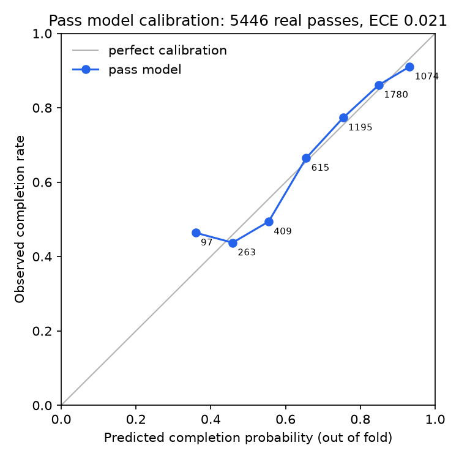

# Evaluation

Every result here was measured at commit `bfa7a57` (20 Oct 2026), the detector frozen for submission, with `uv run filmroom-eval --lens` and `uv run filmroom-eval --calibration`. Each result file records the commit it ran on and whether the tree had uncommitted changes; these ran on a clean tree.

## Results

| Check | Result | Bar (fixed before measuring) |
| --- | --- | --- |
| What was on instead: labelled better player in the engine's top 3 alternatives | **12 of 22 (55%, 95% CI 35–73%)**; random picks 30% | At least half the rows: **pass** |
| … and as the engine's top pick | 6 of 22 (27%, 95% CI 13–48%); random 10% | Reported, no bar |
| Pass model calibration (out of fold) | 5,446 real passes: **ECE 0.021**, Brier 0.154 vs 0.175 for always predicting the completion rate | The headline independent check |
| xG calibration (out of fold) | 440 real shots: ECE 0.052, Brier 0.115 vs 0.135 for always predicting the scoring rate | Reported, no bar |
| Verifier | **2,268 of 2,268** injected errors caught (24 kinds, English and Spanish) | 100% |
| Flip attribution | **2,585 of 2,585** verdict flips between presets trace to one factor both style cards name | 100% |
| Slider directions | **0** violations over 11-step sweeps of all four sliders | 0 |
| Preset disagreement | Possession + High Press vs Counter + Low Block: **52%** of 459 flagged moments; 14 of 15 pairs inside the 15–60% sanity band | Inside the band |

The verifier, flip-attribution and slider-direction checks also run in CI on every push, on a synthetic match (CI has no SoccER data).

### Pass model calibration

| Band | Passes | Mean predicted | Observed |
| --- | ---: | ---: | ---: |
| Low | 373 | 0.43 | 0.45 |
| Medium | 2,219 | 0.69 | 0.69 |
| High | 2,854 | 0.88 | 0.88 |

The app shows success as these bands, so a "high" pass is completed about 88% of the time.

### Turning points (context, not a score)

The turning point is the possession's final decision (see [decisions](decisions.md)). How that compares with the labelled turning points:

| Method | Exact | Within one decision |
| --- | --- | --- |
| Final decision | 19 of 25 (76%, 95% CI 57–89%) | 24 of 25 (96%) |
| Random decision (expected) | 16% | 37% |

### Flag rates

15% of possessions are flagged (459 of 3,128 that didn't end in a goal). By the final action: passes 29%, shots 4%, carries 5%.

## Method

- **Leave one match out.** Every match is analysed with the pass, dribble and xG models fitted on the other matches, and each possession only on data up to the frame it closed. Nothing is tuned on the labels.
- **Reference set.** 25 possessions from the four human-involved matches, at least three completed passes and six seconds long, stratified: 8 ending in a shot or goal, 10 lost in the final third, 7 lost in midfield, both teams represented. Each label gives the turning point, the player, what they did, the better option and why. 22 of the 25 name a better option.
- **What was on instead.** At the labelled turning point, the engine ranks its pass alternatives by value; a row counts if the labelled better player is in the top three (or top one). Random baselines pick alternatives uniformly. Confidence intervals are Wilson 95%.
- **Matching rule** (turning points): exact means the same decision; near means within one decision in the same possession.
- **Calibration** uses every real pass and shot in the dataset, each predicted by the model that never saw its match. ECE is over ten equal-width bins.
- **Lens checks** run over every flagged moment in every match under all six presets. A flip is attributed when one factor, weighted differently by the two styles, contributes most to the change, and both style cards name a principle on it.

## Limits

- **The labels aren't independent.** They were drafted by Claude from position and event data, spot-checked against video twice, and reviewed by the author as a set, not row by row. The same author tunes the detector. The 55% is agreement with our own reference set, not independent accuracy. A blind holdout was written but not labelled, so there is no independent check on turning points.
- **The earlier-turning-point detector failed its gate.** It found the earlier turning point on 0 of the 6 rows where it isn't the final action, so the app marks the final decision instead.
- **Small sample.** 22 rows give wide intervals (35–73% around the 55%).
- **Flag rates for shots and carries are lower than targeted** (4% and 5%). The engine rarely judges a shot or a lost dribble a clear mistake.
- **One preset pair sits just outside the sanity band:** Direct + Low Block vs Counter + Low Block disagree on 14% of moments, against a 15% floor. They share the without-the-ball side and differ only in tempo.
- **Synthetic matches.** SoccER is generated by a game engine, so the models describe that engine's football, not real matches.
